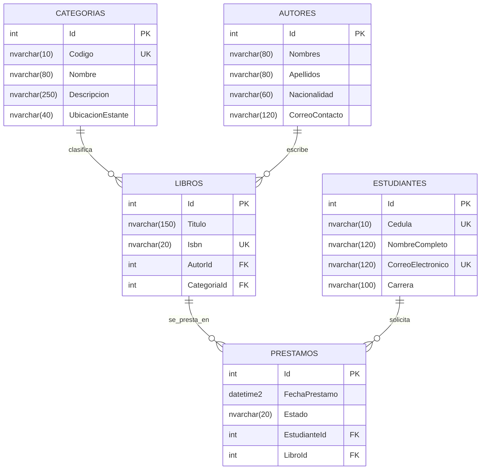

# Documentación Técnica del Proyecto — BiblioCampus

## 1. Información General
- **Asignatura:** Aplicaciones Web — Semana 4, Tarea 1
- **Proyecto:** BiblioCampus (Sistema de Gestión de Biblioteca Universitaria)
- **Arquitectura:** ASP.NET Core MVC (.NET 10.0) con patrón Modelo-Vista-Controlador y Scaffolding de Entity Framework Core
- **Base de Datos:** Microsoft SQL Server (`BiblioCampusDB`)
- **Frontend:** Vistas Razor (`.cshtml`), `_Layout.cshtml`, Tailwind CSS (CDN), CSS y JavaScript nativo en `wwwroot`

---

## 2. Cumplimiento de Requerimientos Académicos

| Requerimiento de la Tarea | Implementación en BiblioCampus | Estado |
| :--- | :--- | :--- |
| Uso de Scaffolding MVC con Entity Framework Core | 5 controladores CRUD completos (`Categorias`, `Autores`, `Libros`, `Estudiantes`, `Prestamos`) con vistas `Index`, `Details`, `Create`, `Edit`, `Delete` | Cumplido |
| Máximo 5 entidades | Exactamente 5 entidades: `Categoria`, `Autor`, `Libro`, `Estudiante`, `Prestamo` | Cumplido |
| 5 atributos por cada entidad | Cada modelo mapea exactamente 5 columnas escalares en SQL Server (incluyendo PK y FKs) | Cumplido |
| Entidades relacionadas entre sí | Grafo relacional totalmente conectado mediante 4 claves foráneas (1:N) con `DeleteBehavior.Restrict` | Cumplido |
| Validaciones con Data Annotations | `[Key]`, `[Required]`, `[StringLength]`, `[RegularExpression]`, `[EmailAddress]`, `[DataType]`, `[Display]`, `[ForeignKey]` | Cumplido |
| Migraciones para Visual Studio Community 2026 | Migración `20261120180000_Inicial` + scripts T-SQL en `/Scripts` + guía de `Package Manager Console` | Cumplido |

---

## 3. Modelo Entidad-Relación (ER)

---

## 4. Diccionario de Datos (5 Entidades × 5 Atributos)

### 4.1 Entidad `Categoria` (Tabla `Categorias`)
| # | Atributo | Tipo C# / SQL | Restricciones y Data Annotations |
| :-: | :--- | :--- | :--- |
| 1 | `Id` | `int` / `int IDENTITY(1,1)` | `[Key]` Clave primaria autoincremental |
| 2 | `Codigo` | `string` / `nvarchar(10)` | `[Required]`, `[StringLength(10, MinimumLength=3)]`, `[RegularExpression(@"^[A-Z]{3}-\d{2,4}$")]`, Índice Único |
| 3 | `Nombre` | `string` / `nvarchar(80)` | `[Required]`, `[StringLength(80, MinimumLength=3)]` |
| 4 | `Descripcion` | `string` / `nvarchar(250)` | `[Required]`, `[StringLength(250, MinimumLength=10)]`, `[DataType(DataType.MultilineText)]` |
| 5 | `UbicacionEstante` | `string` / `nvarchar(40)` | `[Required]`, `[StringLength(40, MinimumLength=3)]` |

### 4.2 Entidad `Autor` (Tabla `Autores`)
| # | Atributo | Tipo C# / SQL | Restricciones y Data Annotations |
| :-: | :--- | :--- | :--- |
| 1 | `Id` | `int` / `int IDENTITY(1,1)` | `[Key]` Clave primaria autoincremental |
| 2 | `Nombres` | `string` / `nvarchar(80)` | `[Required]`, `[StringLength(80, MinimumLength=2)]` |
| 3 | `Apellidos` | `string` / `nvarchar(80)` | `[Required]`, `[StringLength(80, MinimumLength=2)]` |
| 4 | `Nacionalidad` | `string` / `nvarchar(60)` | `[Required]`, `[StringLength(60, MinimumLength=3)]` |
| 5 | `CorreoContacto` | `string` / `nvarchar(120)` | `[Required]`, `[EmailAddress]`, `[StringLength(120)]` |

### 4.3 Entidad `Libro` (Tabla `Libros`)
| # | Atributo | Tipo C# / SQL | Restricciones y Data Annotations |
| :-: | :--- | :--- | :--- |
| 1 | `Id` | `int` / `int IDENTITY(1,1)` | `[Key]` Clave primaria autoincremental |
| 2 | `Titulo` | `string` / `nvarchar(150)` | `[Required]`, `[StringLength(150, MinimumLength=2)]` |
| 3 | `Isbn` | `string` / `nvarchar(20)` | `[Required]`, `[StringLength(20, MinimumLength=10)]`, `[RegularExpression(@"^[\d\-X]{10,20}$")]`, Índice Único |
| 4 | `AutorId` | `int` / `int` | `[Required]`, `[ForeignKey("Autor")]` → `Autores(Id)` (`Restrict`) |
| 5 | `CategoriaId` | `int` / `int` | `[Required]`, `[ForeignKey("Categoria")]` → `Categorias(Id)` (`Restrict`) |

### 4.4 Entidad `Estudiante` (Tabla `Estudiantes`)
| # | Atributo | Tipo C# / SQL | Restricciones y Data Annotations |
| :-: | :--- | :--- | :--- |
| 1 | `Id` | `int` / `int IDENTITY(1,1)` | `[Key]` Clave primaria autoincremental |
| 2 | `Cedula` | `string` / `nvarchar(10)` | `[Required]`, `[StringLength(10, MinimumLength=10)]`, `[RegularExpression(@"^\d{10}$")]`, Índice Único |
| 3 | `NombreCompleto` | `string` / `nvarchar(120)` | `[Required]`, `[StringLength(120, MinimumLength=5)]` |
| 4 | `CorreoElectronico` | `string` / `nvarchar(120)` | `[Required]`, `[EmailAddress]`, `[StringLength(120)]`, Índice Único |
| 5 | `Carrera` | `string` / `nvarchar(100)` | `[Required]`, `[StringLength(100, MinimumLength=4)]` |

### 4.5 Entidad `Prestamo` (Tabla `Prestamos`)
| # | Atributo | Tipo C# / SQL | Restricciones y Data Annotations |
| :-: | :--- | :--- | :--- |
| 1 | `Id` | `int` / `int IDENTITY(1,1)` | `[Key]` Clave primaria autoincremental |
| 2 | `FechaPrestamo` | `DateTime` / `datetime2` | `[Required]`, `[DataType(DataType.Date)]`, `[DisplayFormat(DataFormatString="{0:yyyy-MM-dd}")]` |
| 3 | `Estado` | `string` / `nvarchar(20)` | `[Required]`, `[RegularExpression(@"^(Activo|Devuelto|Atrasado)$")]` |
| 4 | `EstudianteId` | `int` / `int` | `[Required]`, `[ForeignKey("Estudiante")]` → `Estudiantes(Id)` (`Restrict`) |
| 5 | `LibroId` | `int` / `int` | `[Required]`, `[ForeignKey("Libro")]` → `Libros(Id)` (`Restrict`) |

---

## 5. Integridad Referencial y Seguridad
- Todas las relaciones emplean **`DeleteBehavior.Restrict`** (`ON DELETE NO ACTION` en SQL Server) para impedir la eliminación accidental de registros maestros que tengan dependencias activas, mostrando mensajes amigables en pantalla mediante `TempData["Error"]`.
- Todos los formularios POST incluyen **`@Html.AntiForgeryToken()`** (a través de `asp-action`) y el atributo **`[ValidateAntiForgeryToken]`** junto a **`[Bind(...)]`** para prevenir ataques CSRF y *overposting*.
- Las vistas incluyen validación del lado del cliente (`_ValidationScriptsPartial`) y del lado del servidor (`ModelState.IsValid`).
